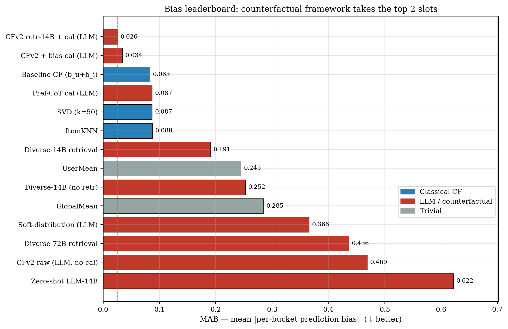
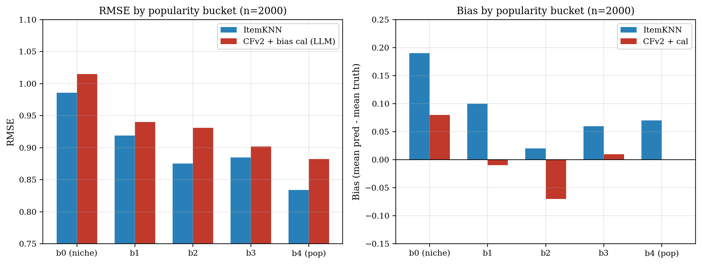
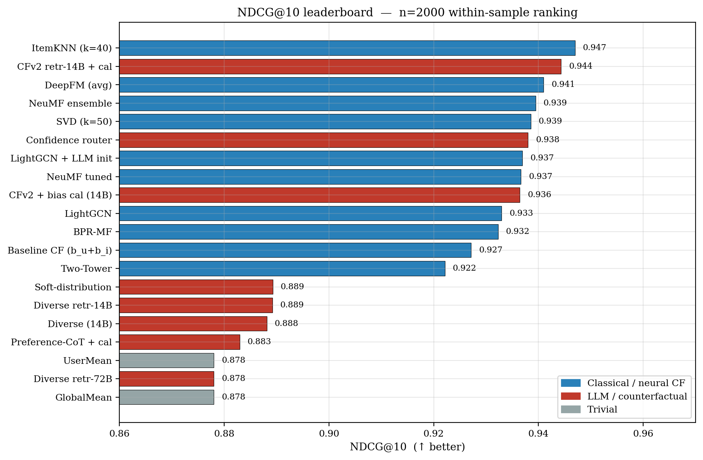

# Counterfactual LLM Reasoning for Popularity-Bias Mitigation in Collaborative Filtering

Can an LLM predict a user's rating from how well the item matches the user's taste, instead of from how popular the item is? This repo tests a three-stage counterfactual pipeline on MovieLens-1M. The stages are **abduction** (the LLM writes k candidate explanations for the user's rating), **intervention** (Time-aware Inverse Propensity Scoring, TIPS, down-weights explanations that rely on popularity) and **prediction**. Its refined variant, **CFv2**, predicts a bounded counterfactual *delta* on top of an ItemKNN reference and then applies a bias calibration. All LLM work uses a self-hosted Qwen2.5-14B-Instruct (plus Qwen2.5-72B-Instruct-AWQ for some runs) served through vLLM. We compare it against classical CF (GlobalMean, UserMean, bias model, SVD, ItemKNN), neural CF (NeuMF, BPR-MF, LightGCN, Two-Tower, DeepFM), alternative LLM prompting strategies and Ridge stackers.

*Context: academic project, April 2026. The full write-up is in [`report/`](report/).*

## Key results

All numbers come from the MovieLens-1M per-user temporal split (last 20% of each user's ratings held out). Evaluation uses a stratified test sample of **n = 2,000** (user, item) pairs, 400 from each of five item-popularity quintiles, with seed 0. **MAB** is the mean absolute per-bucket bias: the mean of |mean prediction − mean rating| over the five popularity buckets. Lower is better.

| Method | MAB ↓ | RMSE ↓ | NDCG@10 (within-sample) |
|---|---:|---:|---:|
| Zero-shot Qwen2.5-14B † | 0.62 | 1.319 | – |
| CFv2, 14B, no calibration | 0.469 | 1.047 | 0.9364 |
| CFv2 + bias calibration, 14B | 0.034 | 0.9354 | 0.9364 |
| **CFv2 + retrieval + bias calibration, 14B** | **0.026** | 0.9032 | 0.9443 |
| ItemKNN (cosine, k = 40) | 0.088 | 0.9012 | **0.9470** |
| SVD (k = 50) | 0.087 | 0.9378 | 0.9385 |
| Bias model (μ + b_u + b_i) | 0.083 | 0.9539 | 0.9271 |
| NeuMF (dim 64), best single model | – | 0.8836 | 0.9366 |
| BPR-MF (dim 64) | – | 0.8888 | 0.9323 |
| **Ridge stacker `v4_minimal`** (17 features, 5-fold CV) | – | **0.8760** | – |
| Per-pair oracle (upper bound) | – | 0.8599 | – |

† The zero-shot baseline was measured on the n = 500 stratified sample: RMSE 1.3191, overall bias +0.62 ([`outputs/14b_n500_1776424046/metrics.json`](outputs/14b_n500_1776424046/metrics.json)).

Sources:
- **MAB:** the bias-leaderboard table in [`report/report_clean.tex`](report/report_clean.tex), also in [`report/make_figures.py`](report/make_figures.py).
- **RMSE:** [`outputs/RESULTS.md`](outputs/RESULTS.md), [`outputs/cf_baseline_n2000_1776428101/summary.csv`](outputs/cf_baseline_n2000_1776428101/summary.csv), [`outputs/overnight_20260417_224911/04_14b_cfv2_retrieval_n2000.log`](outputs/overnight_20260417_224911/04_14b_cfv2_retrieval_n2000.log) and [`outputs/stacker_v4/cv_scores.csv`](outputs/stacker_v4/cv_scores.csv).
- **NDCG@10:** [`outputs/ranking_eval/ranking_results.csv`](outputs/ranking_eval/ranking_results.csv).

What the numbers say:

- **Bias.** Anchoring the LLM on ItemKNN with a bounded delta, then calibrating, lowers MAB from 0.62 (zero-shot) to 0.026, which the report calls a ~96% reduction. The best variant has a per-bucket bias of +0.058 on niche items and −0.007 on blockbusters. That is lower than every classical baseline (ItemKNN 0.088, SVD 0.087).
- **Accuracy.** The best LLM-only method, CFv2 + retrieval + calibration (RMSE 0.9032), comes within 0.002 of ItemKNN (0.9012). Neural CF is still stronger on raw RMSE: NeuMF reaches 0.8836. A Ridge stacker over CF and LLM predictions reaches 0.8760.
- **Ranking.** Ratings ≥ 4 count as positive, and each user's items in the sample are ranked; 278 users are eligible. CFv2 + retrieval + calibration ranks second after ItemKNN: NDCG@10 0.9443 vs 0.9470, HR@1 0.863 vs 0.867. Un-anchored prompting strategies (diverse prompt, soft distribution, preference chain-of-thought) only reach HR@1 ≈ 0.70–0.72.
- **Cold start** ([`outputs/coldstart_pop0_n54_1776426796/summary.csv`](outputs/coldstart_pop0_n54_1776426796/summary.csv) and [`outputs/coldstart_pop20_n500_1776426587/summary.csv`](outputs/coldstart_pop20_n500_1776426587/summary.csv)):
  - On items with no training ratings (n = 54), a 50/50 ItemKNN + LLM hybrid has the best RMSE (0.942, vs 0.944 for CF) and the LLM alone has the best MAE (0.722).
  - On items with ≤ 20 training ratings (n = 500), ItemKNN still wins (RMSE 1.127).
- **Negative findings:**
  - The TIPS α sweep makes no difference: RMSE stays between 1.365 and 1.373 for α ∈ {0, …, 1} and with no intervention (Qwen-72B, n = 500, [`outputs/ablate_n500_1776422339/ablation_table.csv`](outputs/ablate_n500_1776422339/ablation_table.csv)).
  - The original 3-stage pipeline alone does not beat zero-shot: RMSE 1.401 vs 1.319 on the same n = 500 sample.
  - Using the LLM as a confidence router (RMSE 0.9533) does worse than a fixed Ridge blend.

<p align="center">
  
</p>
<p align="center">
  
</p>
<p align="center">
  
</p>

### Caveats (read before citing the numbers)

- **The bias calibration is fitted on the evaluation sample.** In `src/run_cf_v2.py` and `src/run_cf_v2_retrieval.py`, `--calibrate` takes the raw mean bias measured on the same n = 2,000 sample, subtracts it as one global constant (`shift = -m_raw["bias"]`) and clips predictions to [1, 5]. The scripts also build a held-out calibration slice, but they never use it. The calibrated MAB values therefore include the removal of an in-sample constant offset. The substantive finding is that the bounded-delta predictions keep a flat bias profile across popularity buckets once that offset is gone.
- **The zero-shot baseline comes from a different sample.** It was measured on the n = 500 sample, while CFv2 was measured on n = 2,000. Both samples use the same stratification.
- **The 72B retrieval-CFv2 run failed to parse.** Its outputs could not be read on any of the 2,000 calls, so its predictions collapsed to ItemKNN plus an offset (see the Limitations section of the report). `outputs/RESULTS.md` and `report/figures/leaderboard.png` still list "72B CFv2-retrieval + cal, RMSE 0.897", but that is **not** a real LLM result. Headline claims use only the 14B model.
- **Ranking is evaluated within the sample, not over the full catalogue.** Users have roughly 5–7 items in the sample, so HR@3 and above are close to saturated.
- **Stacker scores come from 5-fold CV on the same n = 2,000 sample.**

## Method overview

1. **Data and protocol** ([`src/data.py`](src/data.py), [`src/config.py`](src/config.py)):
   - MovieLens-1M with a per-user leave-last-20% temporal split: 797,758 training and 202,451 test ratings.
   - Test pairs are subsampled with stratification by item-popularity quintile.
   - Prompts include user demographics, up to 20 history items and movie metadata.
2. **Abduction** ([`src/abduction.py`](src/abduction.py)): the LLM generates k = 5 candidate explanations for how the user might rate the target movie.
3. **Intervention, TIPS** ([`src/intervention.py`](src/intervention.py)):
   - Each explanation gets an LLM score for plausibility and for how much it relies on popularity.
   - Item propensities come from rating frequency in 30-day windows.
   - The selection score penalises popularity-reliant explanations, weighted by α.
4. **Prediction:**
   - v1, [`src/prediction.py`](src/prediction.py): the LLM gives a rating derived from the chosen explanation.
   - **CFv2**, [`src/prediction_v2.py`](src/prediction_v2.py): the LLM picks a bounded delta Δ ∈ {−1, −0.5, 0, +0.5, +1} and applies it to an ItemKNN reference prediction. An optional global bias calibration follows (see the caveat above).
   - The retrieval variant ([`src/retrieval_utils.py`](src/retrieval_utils.py)) replaces the most-recent history with the user's rated items that are most similar in content to the target.
5. **Comparison and combination:**
   - Classical CF, re-implemented in NumPy/SciPy.
   - Neural CF in PyTorch.
   - Alternative LLM strategies: diverse pros/cons prompt, log-prob expected rating, soft rating distribution, preference chain-of-thought, analogical anchoring, and an LLM confidence router.
   - LLM-generated item descriptions and user profiles, used as side information (sentence-transformer embeddings feed the LightGCN initialisation and the Two-Tower model).
   - A popularity-routed hybrid and Ridge, RF, GBM and LightGBM stackers.
6. **Evaluation:** RMSE, MAE, signed bias, per-bucket bias and MAB, HR@k, NDCG@k, MRR, plus cold-start slices.

## Repository map

```
src/          all Python code (flat package; run as `python src/<script>.py` from the repo root)
scripts/      shell drivers that chain whole experiment suites (vLLM model switching, logging)
notebooks/    baseline_analysis.ipynb: classical-CF + popularity-bias analysis on the full test split
report/       LaTeX report and slides, figure-generation script, all figures (PDF + PNG)
outputs/      metrics, per-pair predictions and logs for every run (see below)
```

**Shared infrastructure**

| File | Role |
|---|---|
| `src/config.py` | Paths (repo-relative), LLM endpoint (`CF_LLM_BASE_URL`, `CF_LLM_MODEL`, `CF_LLM_API_KEY`), hyper-parameters |
| `src/data.py` | ML-1M loaders, temporal split, stratified sampling, prompt formatters, TIPS propensities |
| `src/data_ml100k.py` | Optional ML-100K loaders with the same schema (not used by the main experiments) |
| `src/llm.py` | OpenAI-compatible client with an SQLite response cache, retries, thread-pool `batch_map`, first-token log-probs |
| `src/retrieval_utils.py`, `src/embed_movies.py` | Content embeddings (TF-IDF title + genres + year) and similar-history retrieval |

**Counterfactual pipeline (LLM)**

| File | Role |
|---|---|
| `src/abduction.py`, `src/intervention.py`, `src/prediction.py`, `src/prediction_v2.py` | The three stages; `prediction_v2` is the CFv2 bounded-delta predictor |
| `src/run.py` | Zero-shot baseline vs. 3-stage pipeline on a stratified sample |
| `src/ablate.py` | TIPS α sweep plus a no-intervention control |
| `src/run_cf_v2.py`, `src/run_cf_v2_retrieval.py` | CFv2 (`--calibrate`) without and with retrieval-augmented history |

**Alternative LLM strategies**

| File | Role |
|---|---|
| `src/baseline.py`, `src/baseline_diverse.py`, `src/baseline_diverse_v2.py`, `src/predict_logprob.py` | Zero-shot, pros/cons ("diverse"), diverse + user stats, log-prob expected-rating predictors |
| `src/run_diverse.py`, `src/run_diverse_retrieval.py`, `src/run_improved.py` | Evaluation drivers for those prompts |
| `src/run_soft_distribution.py`, `src/run_preference_cot.py`, `src/run_analogical.py`, `src/run_confidence_router.py` | Soft rating distribution, preference chain-of-thought, analogical anchoring, LLM-as-router |
| `src/gen_item_descriptions.py`, `src/gen_user_profiles.py`, `src/embed_llm_items.py` | LLM-generated item descriptions and user taste profiles, plus sentence-transformer item embeddings |

**CF baselines**

| File | Role |
|---|---|
| `src/cf_baseline.py` | GlobalMean, UserMean, bias model, truncated SVD, ItemKNN (NumPy/SciPy) |
| `src/neumf.py`, `src/neumf_ensemble.py`, `src/neumf_ens_v4.py`, `src/residual_neumf.py` | NeuMF, multi-seed ensembles, residual NeuMF |
| `src/bprmf.py`, `src/lightgcn.py`, `src/two_tower.py`, `src/deepfm.py` | BPR-MF, LightGCN (optionally with an LLM-embedding initialisation), Two-Tower, DeepFM with side features |

**Ensembles and analysis**

| File | Role |
|---|---|
| `src/routed_hybrid.py` | Popularity-routed CFv2/ItemKNN hybrid and linear-blend sweeps |
| `src/stacker.py`, `src/stacker_v3.py`, `src/stacker_v4.py` | Ridge/RF/GBM stacker (v1/v2), LightGBM + meta-features (v3), final NeuMF-ensemble + genre-affinity stacker (v4) |
| `src/rank_eval.py` | HR@k / NDCG@k / MRR for every method from saved predictions |
| `src/run_coldstart.py`, `src/cold_start_analysis.py`, `src/truly_cold.py`, `src/error_analysis.py` | Cold-start experiments, per-bucket comparison, qualitative error analysis |

**Shell drivers** (`scripts/`): `run_14b_suite.sh` runs the zero-shot vs. 3-stage comparison, the diverse prompt and the TIPS ablation. `run_overnight.sh`, `run_overnight_v2.sh` and `run_overnight_v3.sh` are the overnight suites. They start and stop the vLLM server, switch between 14B and 72B, and log each step under `outputs/overnight*_<timestamp>/`.

**Outputs** (`outputs/`):
- `RESULTS.md`: the full experiment log, including the 31-method leaderboard.
- `<method>_<tag>_<unix-time>/`: `metrics.json` and `predictions.csv` for each run. The CSVs hold per-pair predictions, and for LLM methods the LLM's short rationale.
- `stacker*/`: CV scores and Ridge coefficients.
- `ranking_eval/`: ranking metrics.
- `cold_start_cold_start/`, `coldstart_*/`, `ablate_*/`, `routed_hybrid/`: cold-start, ablation and hybrid results.
- `item_descriptions.json` and `user_profiles.json`: generated with Qwen2.5-14B for all 3,883 movies and 6,040 users.
- `*.log`: run logs.

Downstream scripts pick the most recent run for each method by glob, so the committed predictions are enough to rerun the stackers, the ranking evaluation and the figures without a GPU.

## Setup and reproduction

**Environment.** The original runs used Python 3.10 on a Linux host with an H100 for vLLM. The analysis scripts also run on recent Python versions.

```bash
python -m venv .venv && source .venv/bin/activate
pip install -r requirements.txt          # lightgbm on macOS also needs: brew install libomp
```

**Data.** The public datasets are not included. `src/config.py` expects MovieLens-1M under `data/ml-1m/`:

```bash
mkdir -p data
curl -L -o data/ml-1m.zip https://files.grouplens.org/datasets/movielens/ml-1m.zip
unzip data/ml-1m.zip -d data/            # -> data/ml-1m/{movies,ratings,users}.dat
```

Optional datasets:
- MovieLens-100K for `src/data_ml100k.py`. Download [ml-100k.zip](https://files.grouplens.org/datasets/movielens/ml-100k.zip) and unzip it to `data/ml-100k/`, or set `ML100K_DIR`.
- Amazon Electronics ratings (`ratings_Electronics.csv`) from the [McAuley/UCSD Amazon product data](https://cseweb.ucsd.edu/~jmcauley/datasets/amazon/links.html). The report lists it as future cross-domain work, and no script in this repo reads it yet.

**Serving the LLM.** Any OpenAI-compatible endpoint works. The runs used vLLM 0.19.0:

```bash
vllm serve Qwen/Qwen2.5-14B-Instruct --host 127.0.0.1 --port 8002 \
    --max-model-len 8192 --gpu-memory-utilization 0.8
export CF_LLM_BASE_URL=http://localhost:8002/v1
export CF_LLM_MODEL=Qwen/Qwen2.5-14B-Instruct
# 72B runs: Qwen/Qwen2.5-72B-Instruct-AWQ (the overnight scripts read M72_PATH / VLLM_BIN)
```

Every LLM response is cached in `.cache/llm_cache.sqlite`, keyed by (model, messages, params). The cache is not committed, so rerunning an LLM script sends its requests again.

**Main commands** (run from the repo root):

```bash
# Classical CF baselines on the n=2000 stratified sample
python src/cf_baseline.py --n 2000 --seed 0 --tag n2000

# Zero-shot vs 3-stage counterfactual pipeline, diverse prompt, TIPS ablation (n=500)
bash scripts/run_14b_suite.sh

# CFv2 (bounded delta + calibration), plain and retrieval-augmented
python src/run_cf_v2.py --n 2000 --concurrency 16 --seed 0 --alpha 0.5 --calibrate --tag n2000
python src/embed_movies.py
python src/run_cf_v2_retrieval.py --n 2000 --concurrency 16 --seed 0 --alpha 0.5 --calibrate --tag n2000_14b

# Neural CF baselines
python src/neumf.py  --n 2000 --seed 0 --tag n2000 --epochs 40 --dim 64 --device cpu
python src/bprmf.py  --n 2000 --seed 0 --tag n2000 --dim 64 --epochs 30 --device cpu
python src/neumf_ens_v4.py --n 2000 --seed 0 --tag n2000 --epochs 40 --dim 64 --n_seeds 5 --device cuda

# Stackers, ranking evaluation and figures (CPU only; work from outputs/*/predictions.csv)
python src/stacker.py    --tag n2000 --model_suffixes 14b,72b
python src/stacker_v4.py --tag n2000 --model_suffixes 14b,72b
python src/rank_eval.py
python report/make_figures.py             # writes report/figures/*.pdf|png (needs data/ml-1m)
```

The complete sequence, including LightGCN, Two-Tower, the alternative LLM strategies and cold start, is listed in the Reproducibility section of [`outputs/RESULTS.md`](outputs/RESULTS.md). The overnight drivers in `scripts/` chain those steps.

## Report

- [`report/report_clean.tex`](report/report_clean.tex): the final report.
- [`report/report.tex`](report/report.tex): an extended version with appendices (full leaderboard, stacker coefficients, file index).
- [`report/report_slim.tex`](report/report_slim.tex): a condensed version.
- [`report/slides.tex`](report/slides.tex): the Beamer presentation.

No compiled PDF is included. Build one with `cd report && latexmk -pdf report_clean.tex`, or upload the `report/` folder to Overleaf. The figures are already in `report/figures/`.

## License

[MIT](LICENSE) © 2026 Yash Sinha. MovieLens data is subject to the [GroupLens terms of use](https://files.grouplens.org/datasets/movielens/ml-1m-README.txt). Qwen model weights are subject to their own licenses.
